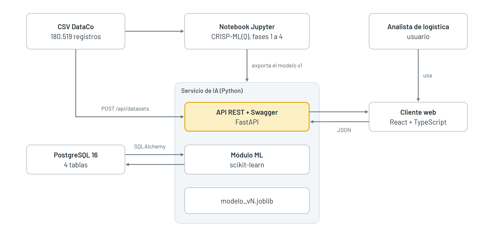

# DataCo: predicción del riesgo de entrega tardía

Trabajo final de **Taller de Sistemas Inteligentes** (Evaluación Unidad 4 y Final).

Modelo de clasificación entrenado con la metodología **CRISP-ML(Q)** sobre el dataset [DataCo Smart Supply Chain](https://www.kaggle.com/datasets/shashwatwork/dataco-smart-supply-chain-for-big-data-analysis). Lo expone un **servicio de IA con API REST** (FastAPI + PostgreSQL) y lo consume un **cliente web** (React).



## Resultados del modelo

| Métrica | Valor | Mínimo exigido |
|---|---|---|
| Accuracy | 0,739 | 0,70 |
| F1-score | 0,734 | 0,70 |
| ROC-AUC | 0,828 | 0,80 |

El modelo usa solo datos conocidos **al registrar el pedido**. Las columnas que revelan el resultado (`Delivery Status`, días reales de envío) se descartaron por fuga de información.

## Entregables

| Entregable | Ubicación |
|---|---|
| Código del servicio de IA | [`backend/`](backend/) |
| Código del cliente web | [`frontend/`](frontend/) |
| Notebook de entrenamiento (CRISP-ML(Q)) | [`notebooks/01_entrenamiento_crisp_ml.ipynb`](notebooks/01_entrenamiento_crisp_ml.ipynb) |
| Diagrama de la base de datos | [`database/README.md`](database/README.md) |
| Script de generación de la base de datos | [`database/schema.sql`](database/schema.sql) |
| Documento Swagger de la API | [`docs/swagger.json`](docs/swagger.json) (y `/docs` con el servicio en marcha) |
| Documento CRISP-ML(Q), servicio y cliente | [PDF](docs/Documento_Proyecto.pdf) · [Word](docs/Documento_Proyecto.docx) |
| Guion del video demostrativo | [`docs/guion_video.md`](docs/guion_video.md) |

## Ejecutar el proyecto

**Requisitos:** Docker, Python 3.12 o superior, Node.js 20 o superior.

### 1. Dataset

Descarga `DataCoSupplyChainDataset.csv` desde Kaggle y colócalo en `data/`. Por su tamaño, los CSV no se incluyen en el repositorio.

### 2. Base de datos

```bash
docker compose up -d        # PostgreSQL en el puerto 5433; ejecuta database/schema.sql
```

### 3. Servicio de IA

```bash
python -m venv .venv
.venv\Scripts\activate                 # Windows  (Linux/macOS: source .venv/bin/activate)
pip install -r backend/requirements.txt

cd backend
python -m app.seed                     # carga el CSV y registra el modelo v1
uvicorn app.main:app --reload --port 8000
```

Swagger UI: <http://localhost:8000/docs>

### 4. Cliente web

```bash
cd frontend
npm install
npm run dev                            # http://localhost:5180
```

### 5. Pruebas

```bash
cd backend
pytest                                 # 18 pruebas; usan una base de datos separada
```

### Re-generar el modelo desde el notebook (opcional)

```bash
pip install -r notebooks/requirements.txt
jupyter nbconvert --to notebook --execute --inplace notebooks/01_entrenamiento_crisp_ml.ipynb
```

El notebook vuelve a escribir `backend/model/modelo.joblib` y `backend/model/metricas.json`.

## API REST

| Método | Ruta | Descripción |
|---|---|---|
| POST | `/api/predicciones` | Enviar datos al modelo y obtener la predicción |
| GET | `/api/predicciones` | Historial de predicciones (datos enviados y resultado) |
| GET | `/api/metricas` | Métricas de rendimiento del modelo activo |
| POST | `/api/modelos/reentrenar` | Re-entrenar el modelo con los datos actualizados |
| POST | `/api/datasets` | Enviar un archivo de entrenamiento (CSV) |
| GET | `/api/modelos` · `/api/datasets` · `/api/opciones` · `/api/destinos` · `/api/salud` | Consultas de apoyo |
| POST | `/api/modelos/{version}/activar` | Volver a una versión anterior |

El detalle está en el [documento del proyecto](docs/Documento_Proyecto.pdf) y en Swagger.

## Estructura

```text
├── backend/          Servicio de IA (FastAPI)
├── frontend/         Cliente web (React + Vite)
├── notebooks/        Entrenamiento con CRISP-ML(Q)
├── database/         Script SQL y diagrama de la base de datos
├── docs/             Documento del proyecto, Swagger, diagramas e imágenes
├── data/             CSV del dataset (no versionado)
└── docker-compose.yml
```
