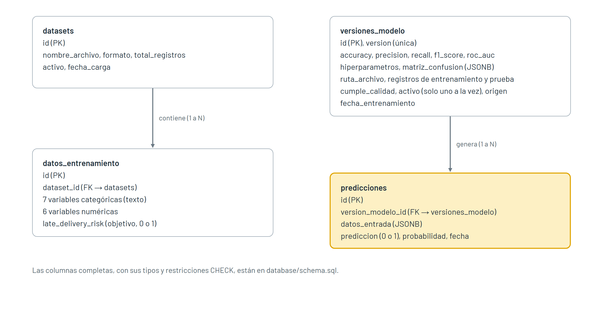
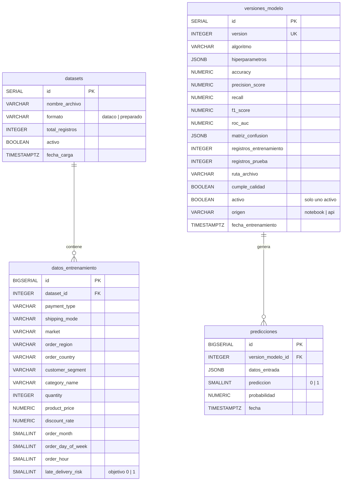

# Base de datos

PostgreSQL 16. El esquema completo está en [`schema.sql`](schema.sql).

## Diagrama





## Tablas

| Tabla | Propósito |
|---|---|
| `datasets` | Archivos de entrenamiento enviados al servicio |
| `datos_entrenamiento` | Registros preparados (13 variables + objetivo) de cada dataset |
| `versiones_modelo` | Cada entrenamiento del modelo con sus métricas e hiperparámetros |
| `predicciones` | Historial de predicciones: datos enviados, resultado y versión del modelo |

**Reglas de integridad:** `CHECK` de rangos y valores válidos, claves foráneas (borrado en cascada de los registros de un dataset), índice único parcial que garantiza **un solo modelo activo** e índices para el historial y el re-entrenamiento.

## Procedimiento de generación

### Opción A: Docker (recomendada)

Desde la raíz del repositorio:

```bash
docker compose up -d
```

`docker-compose.yml` monta `schema.sql` en `/docker-entrypoint-initdb.d/`, así que PostgreSQL lo ejecuta al crear el volumen por primera vez. Base `dataco`, usuario `dataco`, contraseña `dataco`, puerto `5433`.

Para recrear la base desde cero:

```bash
docker compose down -v && docker compose up -d
```

### Opción B: PostgreSQL existente

```bash
createdb -U postgres dataco
psql -U postgres -d dataco -f database/schema.sql
```

Luego configura `DATABASE_URL` en `backend/.env`:

```text
DATABASE_URL=postgresql+psycopg://postgres:<contraseña>@localhost:5432/dataco
```

### Carga inicial de datos

```bash
cd backend
python -m app.seed
```

Inserta los 180.519 registros de `data/DataCoSupplyChainDataset.csv` en `datos_entrenamiento` (con `COPY`, unos 6 segundos) y registra el modelo del notebook como versión 1.

## Consultas útiles

```sql
-- Modelo activo y sus métricas
SELECT version, accuracy, f1_score, roc_auc, fecha_entrenamiento
FROM versiones_modelo WHERE activo;

-- Últimas predicciones con la versión del modelo
SELECT p.id, p.fecha, p.datos_entrada->>'shipping_mode' AS modo, p.prediccion, p.probabilidad, v.version
FROM predicciones p JOIN versiones_modelo v ON v.id = p.version_modelo_id
ORDER BY p.fecha DESC LIMIT 10;

-- Registros activos para entrenar
SELECT s.nombre_archivo, count(*) FROM datos_entrenamiento d
JOIN datasets s ON s.id = d.dataset_id WHERE s.activo GROUP BY s.nombre_archivo;
```
